

  

<h1 align="center">Ticinuum</h1>

  <code>tick-in-YOO-um · TIC(ket) + cont(INUUM)</code> 
  <em>The Continuum of Work.</em>

<h3 align="center">Autonomy you can be accountable for.</h3>

  Ticinuum is an agentic engineering platform. It takes engineering work from ticket to merged code. 
  Its agents plan the change, build it, test it and review each other's work, and it lands only 
  when your checks pass and the people your policy names say yes.

  <a href="https://ticinuum.com"><b>Website</b></a> ·
  <a href="https://ticinuum.com/deep-dive/"><b>Tech details</b></a> ·
  <a href="https://docs.ticinuum.com"><b>Docs</b></a> ·
  <a href="https://ticinuum.com/roadmap/"><b>Live roadmap</b></a> ·
  <a href="https://ticinuum.com/story/"><b>Our story</b></a> ·
  <a href="https://ticinuum.com/#waitlist"><b>Join the waitlist →</b></a>

 

## ◎ How it works

  <a href="https://ticinuum.com/media/explainer/">
    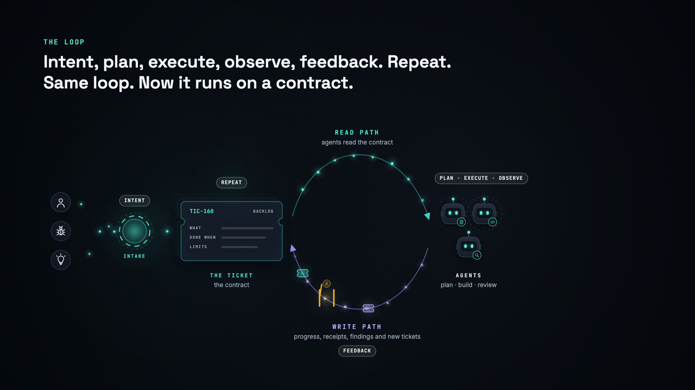
  </a>
   
  <b><a href="https://ticinuum.com/media/explainer/">Watch the 1:47 explainer, with sound →</a></b> · <a href="assets/explainer.mp4">or get the video file</a> 
  Intent becomes a ticket, and the ticket is the contract. Agents read it to do the work and write back to it; humans govern it. An animation, not the app: its tickets, names and figures are illustrative. "Observe" here means tests, review and findings, not production monitoring.

## ▶ Watch it work

  <a href="https://ticinuum.com/media/demo-2026-11-14.mp4">
    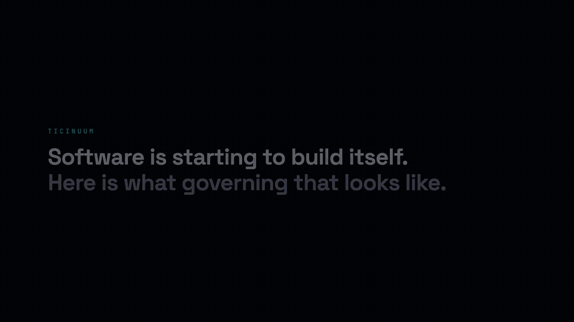
  </a>
   
  <b><a href="https://ticinuum.com/media/demo-2026-11-14.mp4">Watch the full 1:24 tour, with sound →</a></b> 
  Shown here at 4× speed. Recorded Nov 10, 2026 in Ticinuum's own org. Dollar figures are the API list price of the tokens used. Patrols, near the end, are built but not yet validated.

## ✦ Ticinuum builds Ticinuum

  <a href="https://ticinuum.com/roadmap/">
    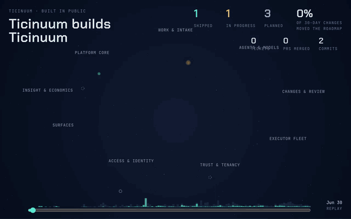
  </a>
   
  Each star is a roadmap item and each streak is a deployed change, July to November 2026. <b><a href="https://ticinuum.com/roadmap/">Explore the live constellation →</a></b>

On July 4, 2026, Ticinuum started helping build Ticinuum. Here is what the work on it has added up to so far:

<table align="center">
  <tr>
    <td align="center" width="25%"><h2>1,074</h2>tickets</td>
    <td align="center" width="25%"><h2>2,810</h2>pull requests merged</td>
    <td align="center" width="25%"><h2>6,075</h2>commits</td>
    <td align="center" width="25%"><h2>52</h2>roadmap items shipped, 24 more in progress</td>
  </tr>
</table>

Work on Ticinuum, June 16 to November 8, 2026, counted from the <a href="https://ticinuum.com/roadmap/">interactive roadmap</a>. Over half of the codebase is tests, on purpose: if a ticket is a contract, tests are much of the evidence that the work is done.

## ◆ One real ticket, start to finish

**TIC-2115**, from Ticinuum's own backlog: *"give every setting a working control in the web app."* A person filed it on October 18, 2026. Once it started, no one stepped in.

<table>
  <tr>
    <td width="42%" valign="top">

| UTC | Who | What happened |
|---|---|---|
| 05:50 | **Groomer** | Turned the request into a brief with ten success criteria. |
| 06:05 | **Developer** | Built the change (20 files), tested it, and opened a pull request. |
| 06:36 | **Reviewer** | Found two tests the change had broken. Sent it back. `changes requested` |
| 06:47 | **Reviser** | Fixed both and pushed a new revision. |
| 06:52 | **Reviewer** | Re-read what changed. Approved. Six checks passed. |
| 07:01 | **Platform** | Merged, under our org's on-record choice to let approved, green work land. |

</td>
    <td width="58%" valign="top">
      <a href="assets/screens/ticket-overview.png">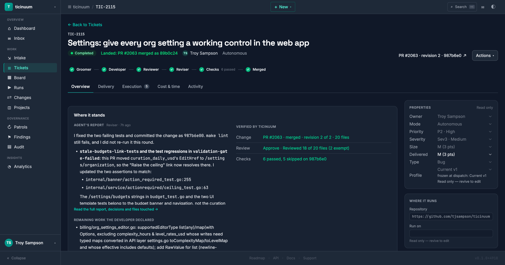</a>
       The ticket page: the agents' own report beside what Ticinuum verified for itself. The change merged, the review approved and the checks passed.
    </td>
  </tr>
</table>

<table align="center">
  <tr>
    <td align="center" width="25%"><h2>1h 10m</h2>request to merged</td>
    <td align="center" width="25%"><h2>5</h2>agent runs</td>
    <td align="center" width="25%"><h2>$3.64</h2>model usage at published API rates</td>
    <td align="center" width="25%"><h2>2</h2>broken tests caught before merge</td>
  </tr>
</table>

Our org lets the platform merge work that passed review and checks. Yours starts with a person's final yes, and changes only when you choose, on the record. <a href="https://ticinuum.com/deep-dive/#build">See every tab of this ticket →</a>

<table>
  <tr>
    <td width="33%" valign="top"><a href="assets/screens/ticket-execution.png">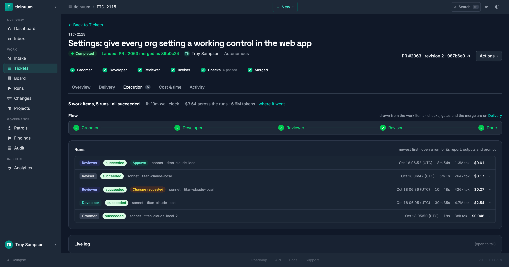</a> <b>Execution.</b> Five runs: the Groomer, the Developer, a Reviewer that asked for changes, the Reviser, and a Reviewer that approved. Each shows its model, duration, tokens and price.</td>
    <td width="33%" valign="top"><a href="assets/screens/ticket-delivery.png">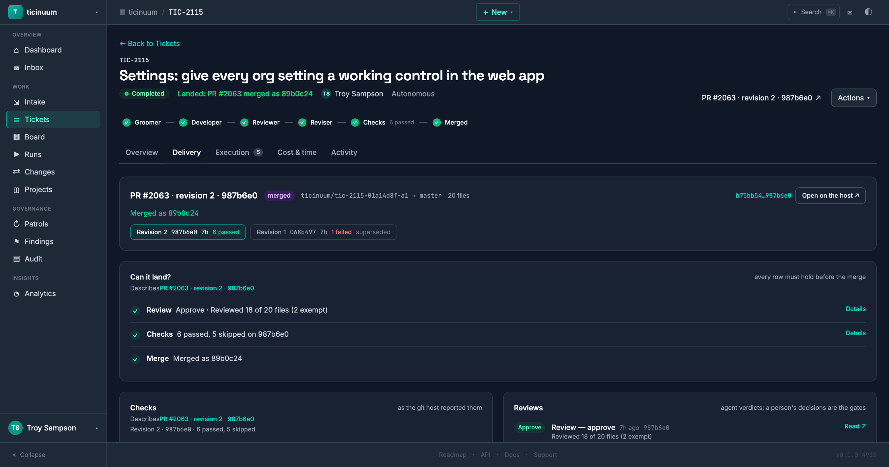</a> <b>Delivery.</b> Can it land? Every row must hold before the merge. Revision 1 failed a check and was superseded. Revision 2 passed review and checks, and merged.</td>
    <td width="33%" valign="top"><a href="assets/screens/ticket-cost-and-time.png">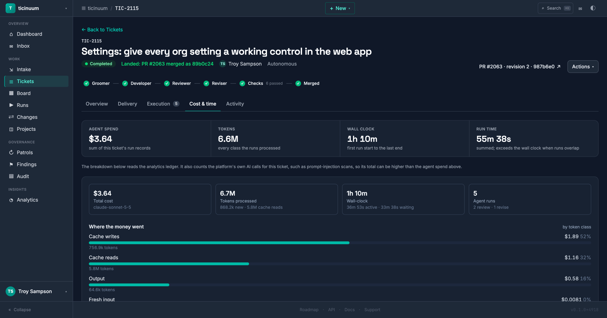</a> <b>Cost &amp; time.</b> Where the money went, by token class. Most of this ticket's cost was prompt-cache writes, not output.</td>
  </tr>
</table>

## ⚙ Delivery is the benefit. Governance is why you can trust it.

Budgets, policy and a tamper-evident record govern every step. That is what lets you move fast without lowering the bar: engineering done the right way, at machine speed.

|  |  |
|---|---|
| 🔀 **Real pull requests** | The work lands as a pull request on GitHub or a merge request on GitLab. |
| 🔍 **A second agent checks the first** | The reviewer is a fresh agent, never the one that wrote the code, and the merge waits for its approval and green CI. |
| ✋ **A person gives the final yes, by default** | Letting the agent merge on its own is a choice your org makes on the record, and that choice lapses after 90 days unless an admin re-confirms it. |
| 💵 **Spend has a ceiling** | A daily budget in real dollars pauses the org when it is reached. Where the system cannot confirm that spend is safe, it refuses to run. |
| 📜 **Everything is on the record** | Each state change and the event describing it are written in the same database transaction, so the timeline cannot drift from what happened. |
| 🔑 **Your model key, your quota** | Agents run on your own Anthropic API key, Claude subscription or AWS Bedrock account, with no markup on that spend. |

## ▦ One record, every seat at the table

<table>
  <tr>
    <td width="50%" valign="top"><a href="assets/screens/dashboard-mission-control.png">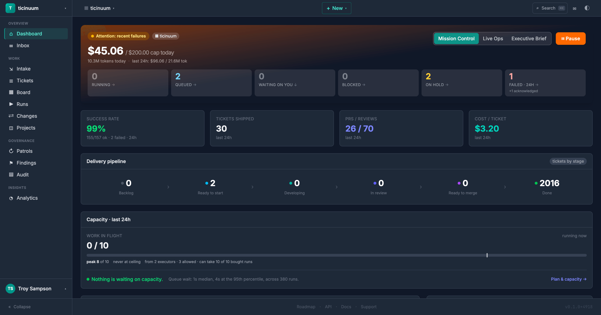</a> <b>Mission Control.</b> Success rate, tickets shipped, pull requests and reviews, the delivery pipeline, and how much of the capacity you bought is in use.</td>
    <td width="50%" valign="top"><a href="assets/screens/board.png">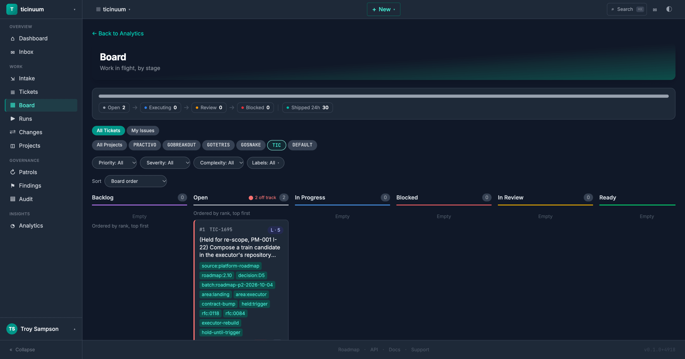</a> <b>Board, ranked.</b> Work in flight by stage, in rank order, with any ticket drifting from what similar past work took flagged as off track.</td>
  </tr>
  <tr>
    <td width="50%" valign="top"><a href="assets/screens/settings-budget-limits.png">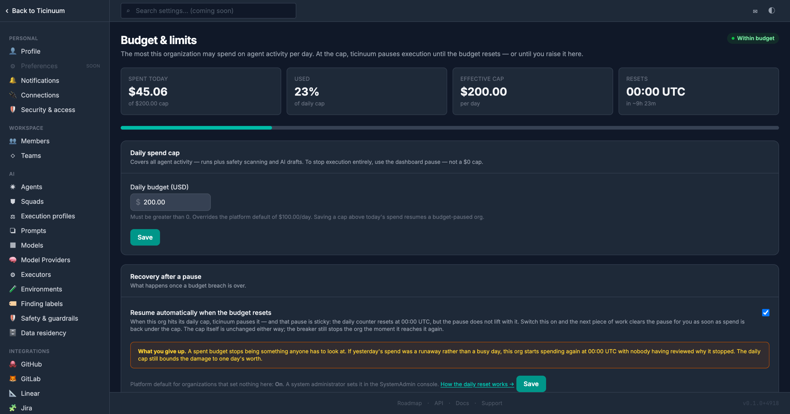</a> <b>Budget &amp; limits.</b> The daily cap, in real dollars. At the cap Ticinuum pauses new work. Whether it resumes on its own at the next reset is your org's choice, and what you give up is spelled out beside the switch.</td>
    <td width="50%" valign="top"><a href="assets/screens/audit.png">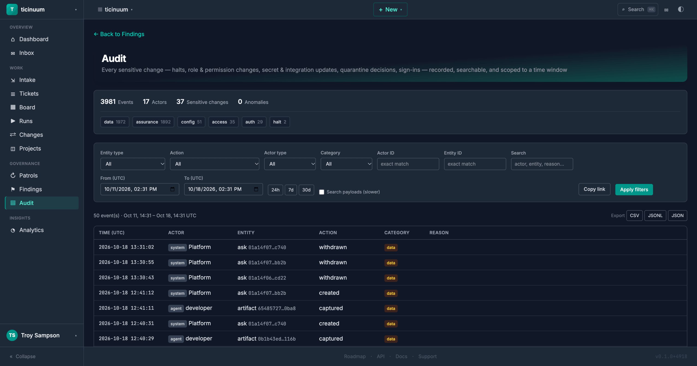</a> <b>Audit.</b> Every sensitive change (halts, roles, secrets, quarantine decisions, sign-ins) in an append-only, hash-chained stream, exportable as CSV, JSONL or JSON.</td>
  </tr>
</table>

<b>More from the product (6 more screens)</b>

 
<table>
  <tr>
    <td width="50%" valign="top"><a href="assets/screens/analytics-agent-quality.png">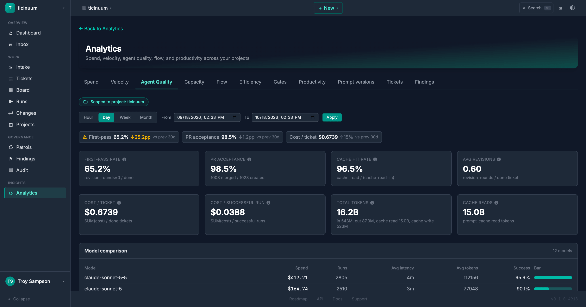</a> <b>Agent quality.</b> First-pass rate, pull-request acceptance, cache hit rate, cost per ticket and per successful run, and a model-by-model comparison.</td>
    <td width="50%" valign="top"><a href="assets/screens/analytics-flow.png">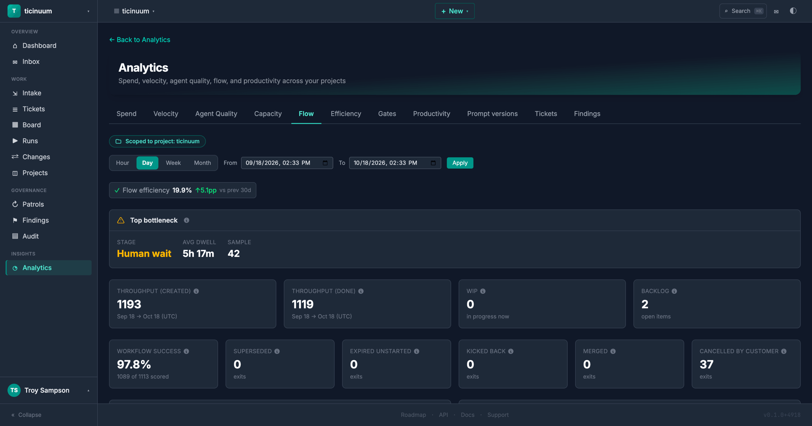</a> <b>Flow.</b> Flow efficiency and the top bottleneck. Here the slowest stage is waiting on a person, not on an agent.</td>
  </tr>
  <tr>
    <td width="50%" valign="top"><a href="assets/screens/settings-safety.png">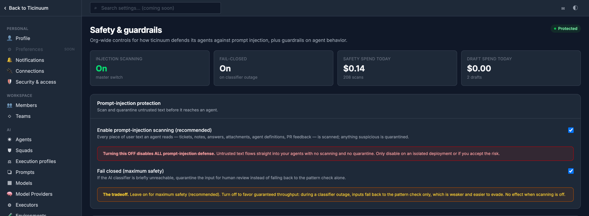</a> <b>Safety &amp; guardrails.</b> Prompt-injection scanning and its fail-closed posture, each with the cost of turning it off written beside the switch.</td>
    <td width="50%" valign="top"><a href="assets/screens/findings.png">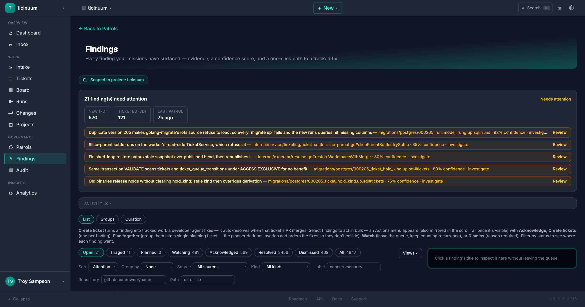</a> <b>Findings.</b> What agents noticed along the way, each with its evidence and a confidence score. A finding becomes a ticket only when a person promotes it.</td>
  </tr>
  <tr>
    <td width="50%" valign="top"><a href="assets/screens/ticket-activity.png">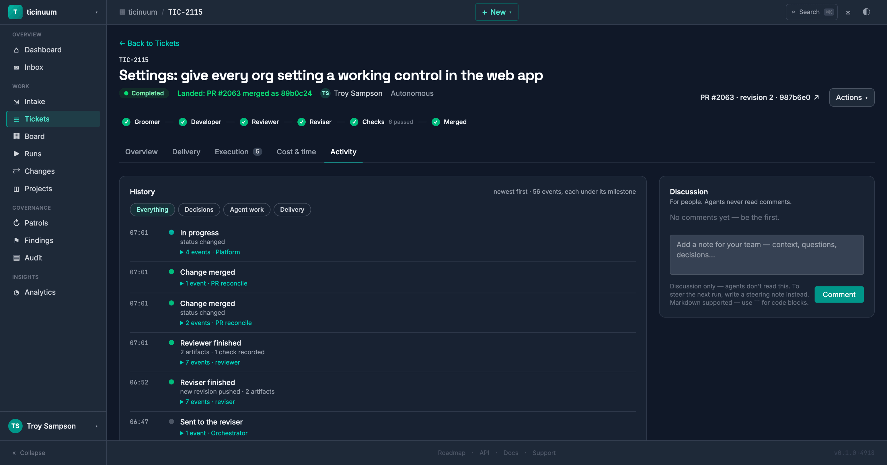</a> <b>Activity.</b> Fifty-six events rolled into milestones, each one attributed. The discussion beside it is for people; agents never read it.</td>
    <td width="50%" valign="top"><a href="assets/screens/changes-truth.png">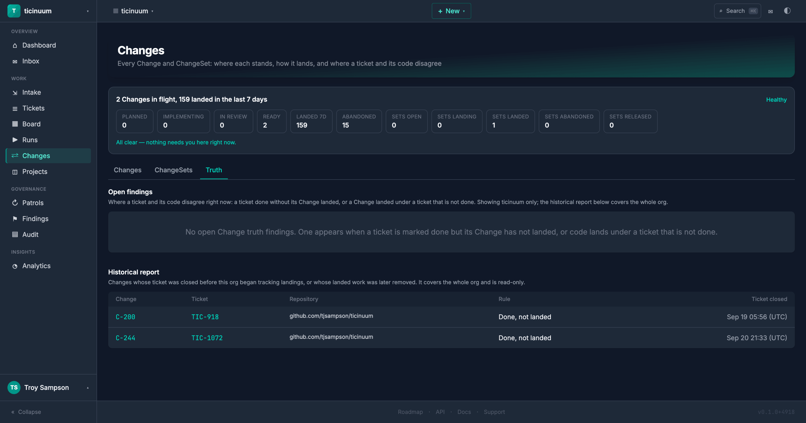</a> <b>Changes, Truth.</b> Where a ticket and its code disagree. A ticket marked done whose change never landed is listed, not buried.</td>
  </tr>
</table>
Every screen is a real capture from Ticinuum's own org, taken October 18, 2026. That org's dollars are the model's API list price for its tokens, not a cost benchmark.

 

---

  <b>Coding assistants help a person write code. Ticinuum delivers the work, and governs it.</b>

  <a href="https://ticinuum.com/#waitlist"><b>Join the waitlist →</b></a>
  &nbsp;·&nbsp;
  <a href="https://ticinuum.com">ticinuum.com</a>
  &nbsp;·&nbsp;
  <a href="https://docs.ticinuum.com">docs.ticinuum.com</a>

